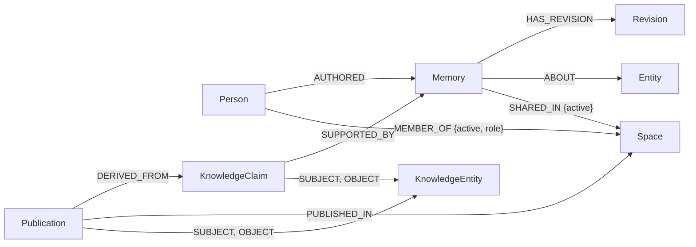

# Memspace

One memory graph that every AI assistant you use can read and write, with permissioned sharing between people. Built on FalkorDB.

Memspace was called Shared Memory until recently, which is why the repository, package and skill names still say `shared-memory`.

Graph Hacks submission, track **Agent Memory and Coordination**, by team Santology.

| | |
|---|---|
| Live dashboard | https://shared-memory-mcp-sandbox.up.railway.app/dashboard |
| MCP endpoint | `https://shared-memory-mcp-sandbox.up.railway.app/mcp` |
| Cypher queries and graph algorithms | [docs/cypher.md](docs/cypher.md) |
| Runnable queries and sample graph | [cypher/](cypher) |

The live links run the latest `codex/development` build. [Production](https://shared-memory-mcp-production.up.railway.app/dashboard) runs `main` and is updated when a release is promoted.


## What it does

Most people now use more than one assistant, and each one starts from zero. What you tell one is invisible to the others, and there is no way to share part of what you know with a teammate's assistant on your terms.

Memspace is a remote MCP server. Any assistant that supports Streamable HTTP with OAuth can connect to it; we use it with Meta Muse, Grok Bot, ChatGPT's Dot and Codex. Once connected, an assistant can:

- save what you tell it, with the quote it came from and which assistant saved it
- recall related context later, from any of your connected assistants
- correct a memory with full revision history, or forget it everywhere
- turn each memory into typed claims (people, projects, tasks, preferences, obligations and more), each tied to its evidence
- share a single memory or a single claim into a space you belong to
- check a space, or your own memory, on a schedule and tell you what changed

Your memory is private by default. A space owner invites people by verified email, as readers or contributors, and can revoke them at any time.

## Why it is a graph

FalkorDB is not storage behind an API here. The product's core behaviour is graph traversal:

- **Permissions are paths.** A memory is readable only by its author, or through an active `Person -MEMBER_OF-> Space <-SHARED_IN- Memory` path, checked on every read. Revoking a member or retracting a share flips one edge.
- **Recall follows edges.** After a keyword match, recall hops through shared entities and spaces to bring back related memories that share no words with the query, and says what connected them.
- **Search runs in the graph.** Claims are searched with FalkorDB's full-text and HNSW vector indexes, filtered by the same permission paths, and fused by reciprocal rank.
- **Teammates meet at one node.** In a space, every author's mentions of the same member resolve to one node, so facts about a person collect in one place.
- **Writes are safe to retry.** Parameterized Cypher, compare-and-swap revisions and idempotent `MERGE`. Background extraction is a lease-based queue stored in the graph.

Every query, with what it does and why it needs a graph, is in [docs/cypher.md](docs/cypher.md).

## Graph data model



| Node | Meaning |
|---|---|
| `Person` | A signed-in account. All of a person's assistants act as this one node. |
| `Memory` | One saved statement or outcome: kind, text, evidence quote, owner, source assistant, current revision. |
| `Revision` | An earlier version of a memory. Only the author can read history. |
| `Entity` | A person, project, place or topic a memory is about, scoped to its owner. |
| `Space` | A shared space. Members join through invitations. |
| `KnowledgeClaim` | A typed fact extracted from a memory revision, such as `Afshal WORKS_ON Apollo`, with the exact evidence. Corrections form a `SUPERSEDES` chain. |
| `KnowledgeEntity` | The subject or object of a claim. |
| `Publication` | A frozen copy of a claim shared into a space. |

Memory kinds are fact, preference, event, goal, task, decision and relationship. Event time and recorded time are stored separately. The graph also holds search documents, the extraction job queue, change records for spaces, connected assistants, sharing rules and proposed relationship types; the full model is in [docs/cypher.md](docs/cypher.md#graph-model).

## Run it locally

### See the graph in two commands

No accounts or API keys needed. This builds a sample graph through the product's own code and runs the documented queries against it.

```bash
docker run -d --rm --name falkordb-demo -p 6379:6379 -p 3000:3000 falkordb/falkordb:latest
npm ci && npm run graph:demo -- --keep
```

Then open FalkorDB Browser at http://localhost:3000 and pick the `shared_memory_demo` graph. Details, sample data and expected results are in [cypher/README.md](cypher/README.md).

### Run the full app

You need Node 24, Docker and a [Clerk](https://clerk.com) application. An OpenRouter key is optional and turns on vector search and automatic claim extraction.

1. Start FalkorDB with a password:

   ```bash
   docker run -d --name shared-memory-falkordb -p 6379:6379 \
     -e REDIS_ARGS="--requirepass change-me" falkordb/falkordb:latest
   ```

2. Copy `.env.example` to `.env.local` and fill it in:

   | Variable | Value |
   |---|---|
   | `CLERK_PUBLISHABLE_KEY`, `CLERK_SECRET_KEY` | From your Clerk application |
   | `CLERK_ACCOUNT_PORTAL_URL` | Your Clerk instance, e.g. `https://your-instance.accounts.dev` |
   | `CLERK_WEBHOOK_SIGNING_SECRET` | Optional. Signs Clerk user webhooks |
   | `PUBLIC_URL` | The origin you open in the browser, e.g. `http://localhost:3000` |
   | `FALKORDB_HOST`, `FALKORDB_PORT`, `FALKORDB_PASSWORD` | `127.0.0.1`, `6379` and the password above |
   | `FALKORDB_GRAPH` | Graph for account profiles, e.g. `shared_memory` |
   | `FALKORDB_MEMORY_GRAPH` | Graph for memories, spaces and claims, e.g. `shared_memory_app` |
   | `EMBEDDING_PROVIDER`, `OPENROUTER_API_KEY` | `openrouter` and your key to enable vector search, or `disabled` |
   | `ONTOLOGY_PROVIDER`, `ONTOLOGY_MODEL` | `openrouter` and a model (default `openai/gpt-4.1-mini`) for claim extraction, or `disabled` |
   | `ONTOLOGY_ADMIN_EMAILS` | Comma-separated emails that may approve, merge or reject proposed relationship types |

   Keep keys in `.env.local` only; it is ignored by git.

3. Install, build and start:

   ```bash
   npm ci
   npm run build
   npm run dev
   ```

   The dashboard is at http://localhost:3000/dashboard and the MCP endpoint at http://localhost:3000/mcp. For frontend work, run `npm run dev:web` in a second terminal; Vite forwards API requests to port 3000.

Hosted assistants cannot reach `localhost`. To connect one, deploy the app (see [Deployment](#deployment)) or expose it over HTTPS and set `PUBLIC_URL` to that address.

### Tests

```bash
npm run build && npm run check:web && npm test
```

checks compilation, frontend types, OAuth isolation and signed Clerk webhooks. The graph tests need an isolated FalkorDB on `127.0.0.1:16379` with password `local-verification`:

```bash
docker run -d --name smm-test-falkordb -p 127.0.0.1:16379:6379 \
  -e REDIS_ARGS="--requirepass local-verification" falkordb/falkordb:latest
npm run test:graph
node --import tsx --test test/api.integration.ts
```

Each test creates its own uniquely named graph and deletes it afterwards. `FALKORDB_TEST_HOST`, `FALKORDB_TEST_PORT` and `FALKORDB_TEST_PASSWORD` override the defaults. The suite covers concurrent deduplication, stale revisions, private retrieval, relationship expansion, invitations, sharing and retraction, sharing rules, client revocation, claim publication, member linking, space-scoped reads, both MCP protocol versions, and the queries in [cypher/](cypher).

The sandbox deployment, synthetic multi-user accounts and the release flow are described in [docs/development.md](docs/development.md).

## Connect an assistant

Create an account on the dashboard and open **Connections**. Pick your assistant (Dot, Muse or Grok Bot) and follow the two steps:

1. **Copy install prompt** (also at `GET /setup/prompt`) gives the assistant the setup recipe for this deployment's MCP URL. Setup is complete when an authenticated `get_connection_status` call succeeds; signing in through the browser alone is not enough.
2. **Copy instructions skill** (`GET /skill/dot`, `/skill/muse` or `/skill/grok-bot`) gives the assistant one skill that covers everyday memory use and a timed watch in its own scheduler. The watch can follow a shared space, or your own memories saved by your other assistants, matched by `sourceClient` against the `client.id` that `get_connection_status` returns.

The server does not wake assistants. A watch exists only if the assistant reports creating it. Assistant names come from the client ID metadata document for URL client IDs and from the Clerk OAuth application for dynamically registered ones; the `list_assistants` tool and the dashboard show the same names.

Connecting gives that assistant access to your memory tools. Each connection can be revoked in **Connections**. A host still has to call the tools: connecting does not import whole chats or guarantee automatic saves, and a prompt pasted into one chat does not persist across chats. For that, install the skill or save the guide in the host's persistent instructions.

A successful save returns a receipt. The dashboard shows the source assistant, entity links, claims and revisions for every memory.

### MCP tools

| Tool | Purpose |
|---|---|
| `remember`, `recall`, `get_memory` | Save, search and read memories |
| `revise_memory`, `forget_memory`, `explain_memory` | Correct with history, forget everywhere, show the revision trail |
| `record_knowledge`, `recall_knowledge`, `index_knowledge`, `get_ontology` | Structured claims and their search |
| `list_spaces`, `share_memory`, `publish_claim`, `get_shared_update` | Spaces and sharing |
| `list_assistants`, `get_connection_status`, `memory_instructions` | Connected assistants, the caller's identity, the operating guide |

### OAuth requirements

These must hold for every client. They are what made Muse, a public client, work.

| Parameter | Value |
|---|---|
| MCP resource | Exactly this deployment's `/mcp` URL |
| `resource=` | Sent on both authorize and token requests and kept on refresh (RFC 8707). Append `?resource=<MCP URL>` to the registered `authorization_url` and `token_url`; no separate field is needed |
| Scopes | `openid profile email offline_access` |
| Client authentication | PKCE `S256`, `token_endpoint_auth_method: none`, no client secret |
| Registration | Dynamic client registration via the `registration_endpoint` in `/.well-known/oauth-authorization-server` |

OIDC discovery (`/.well-known/openid-configuration`) can omit `registration_endpoint`, so read the authorization-server metadata before concluding that dynamic registration is unavailable. Client ID metadata documents (CIMD) also work when `client_id_metadata_document_supported` is true. Leave the client ID and secret fields blank for either. If a host supports neither, register a public OAuth application in Clerk (below) and give the host only its client ID.

A 401 `invalid_token` with an audience mismatch means the token was not bound to the MCP URL, almost always because dynamic registration or `resource=` was missing. That is a client configuration problem, not a workspace policy.

**ChatGPT.** Open [ChatGPT Plugins](https://chatgpt.com/plugins), choose **+ → Add custom MCP server**, enter the endpoint and OAuth settings, install the plugin, authorize it, then select it with `@` in a chat. Availability depends on the workspace's permissions. The owner account can install the private [Memspace plugin](https://chatgpt.com/plugins/plugins_6ad00b37b7148191a76953dc3d1bcad0), which bundles the skill and the MCP connection; the link does not work for other accounts.

**Skills.** MCP `memory_instructions` returns `skills/shared-memory/SKILL.md`, which `/skill` and `/skill/SKILL.md` also serve. When releasing a plugin update, keep each `skills/<name>/` tree identical to `plugin/shared-memory/skills/<name>/` (the plugin may add host-only `agents/`).

### Clerk setup

Clerk instance `https://organic-buck-9271.clerk.accounts.dev`, application `app_3KhaoAVxRR0XFfeOzTL2AqaNZoF`. Never use another application's keys.

Under **OAuth applications → Settings**:

1. **Client onboarding.** Enable **Publish DCR support** (Muse registers dynamically) and **Publish CIMD support**. Set the default scopes for dynamic clients to at least `profile` and `email`, plus `openid` and `offline_access` for hosts that omit `scope` but need refresh tokens.
2. **Authorization security.** Enable **Require PKCE**.
3. Keep audience binding on. The server verifies Clerk tokens with `audience` set to the MCP URL and explains a mismatch in the `invalid_token` detail. Clerk accepts authorize and token requests without `resource=`, so clients must send it themselves.

For a manual public client: **OAuth applications → Applications → Add application**, enable **Public** and **Require PKCE**, add the host's exact redirect URIs (for the local verifier, `http://127.0.0.1:<port>/callback`), allow `profile` and `email`, and give the host the client ID only.

To check the full flow by hand (authorization code with PKCE, `resource=` on both requests, then `initialize`, `tools/list` and `get_connection_status`):

```bash
pip install requests
python3 scripts/verify_oauth_mcp.py
```

Optional variables: `MCP_URL` (defaults to production `/mcp`), `CLIENT_ID` (skips registration), `REDIRECT_URI` and `OAUTH_SCOPES`. The script opens a browser for sign-in and never stores secrets.

## Spaces and sharing

An owner invites a reader or contributor by verified primary email, and the invitee accepts while signed in with that email. Contributors can share their own memories but never edit someone else's. Owners can revoke members, and an old invitation link cannot restore revoked access; that needs a new invitation.

A shared memory is a reference, not a copy. Every read and every recall hop checks the current path, so a correction to the source shows up on the next read and a retraction stops future retrieval. Content another host has already received cannot be pulled back.

Sharing a memory also publishes the claims extracted from it into the space. A claim can be shared on its own as a frozen `Publication`, so later private corrections never silently change what teammates already received. Inside a space, a person mentioned by name is linked to the matching member when exactly one member matches.

Sharing happens on an explicit request or through a sharing rule set on the dashboard, matching a memory kind and optionally an entity name. Rules apply to future saves only, stop when disabled or when permission is lost, and do not retract earlier shares.

Members read updates on demand with `recall`, `recall_knowledge` and `get_shared_update`, scoped to one space. The server speaks the stateless `2026-07-28` MCP protocol and the legacy `2025-11-25` protocol on the same endpoint. It does not push updates; agents check on their own schedule through the watch skills.

## Memory lifecycle

Revisions are compare-and-swap: a correction applies only if the memory is still at the revision the caller last read, so two assistants cannot overwrite each other. Revision history is visible only to the author, so an old private version never leaks through a newly shared reference.

Saves and corrections queue a background extraction job. Claims are attached to the exact revision they came from; negative statements are stored as negated claims, and relationships the ontology does not cover are proposed as provisional types for review rather than forced into the wrong one. A memory with nothing the ontology can hold is marked "Not in ontology" on the dashboard and can be retried later. Agent-reported outcomes are recorded with their source but not independently verified.

Forgetting removes text, evidence and revision contents, withdraws shares, clears the claims and publications derived from the memory, deletes their search documents and removes orphaned entities. Minimal IDs and timestamps remain for audit.

## Deployment

Railway project `e13f89d3-e41a-4e89-96b8-dbdc0b1f87cd` in Pranav's Hobby workspace. The `shared-memory-mcp` service builds the Dockerfile; `falkordb` runs the official server image on the private network. The API binds to `0.0.0.0` and uses Railway's `PORT`.

Database variables reference `${{falkordb.RAILWAY_PRIVATE_DOMAIN}}` and `${{falkordb.FALKORDB_PASSWORD}}`. A volume at `/var/lib/falkordb/data` with append-only persistence keeps the data. `/health` checks database connectivity.

`codex/development` deploys to the sandbox after CI passes, and `main` deploys to production; see [docs/development.md](docs/development.md). The original scope and acceptance plan are in [docs/implementation-plan.md](docs/implementation-plan.md); the broader notification adapters and proactive inference engine described there are not built.

## Team

Santology: Pranav Janakiraman ([@pranavjana](https://github.com/pranavjana)), Afshal Gulam ([@AfshalG](https://github.com/AfshalG)) and Roshan Premil ([@Rosh2403](https://github.com/Rosh2403)).

We used AI coding assistants (OpenAI Codex, Cursor's agent and Claude Code) to write code and documentation under our direction. Changes went through pull requests, with tests against a local FalkorDB and checks on the sandbox before merging.
