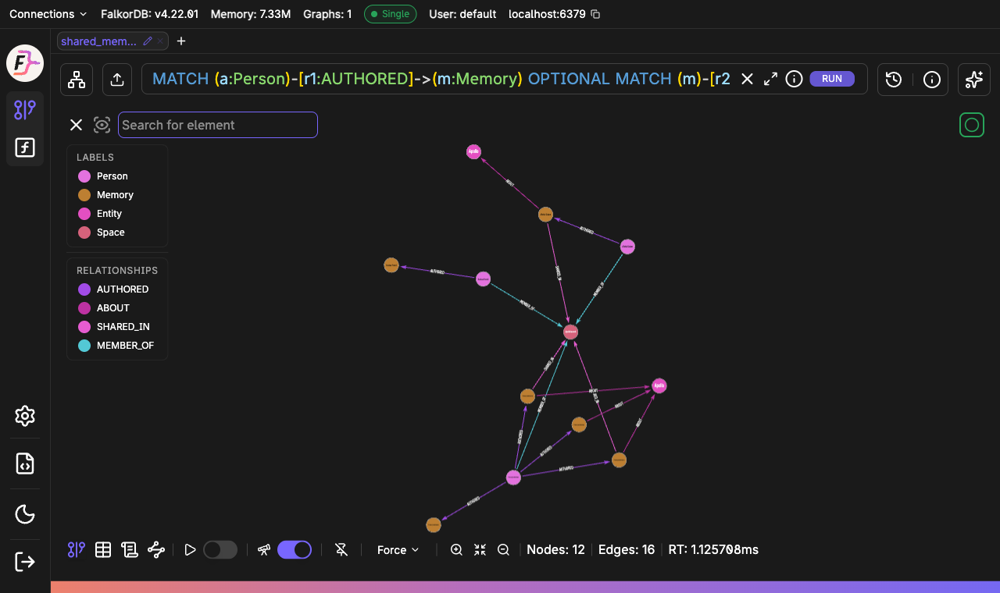

# Cypher

The schema and the core read queries Memspace runs on FalkorDB, as files you can execute. The full set of queries, including writes, is explained in [docs/cypher.md](../docs/cypher.md).

| File | Question it answers | Used by |
|---|---|---|
| [`schema.cypher`](schema.cypher) | Which indexes and constraints exist? | `MemoryStore.init`, `src/memory.ts` |
| [`queries/01-can-read.cypher`](queries/01-can-read.cypher) | Can this person read this memory? | `access()`, appended to every memory read |
| [`queries/02-recall-keyword.cypher`](queries/02-recall-keyword.cypher) | Which memories I can read match these words? | `recall`, step 1 |
| [`queries/03-recall-via-entity.cypher`](queries/03-recall-via-entity.cypher) | What else is about the same project, person or topic? | `recall`, step 2 |
| [`queries/04-recall-via-space.cypher`](queries/04-recall-via-space.cypher) | What did teammates share next to it? | `recall`, step 3 |
| [`queries/05-space-feed.cypher`](queries/05-space-feed.cypher) | What has been shared in this space? | `spaceMemories` |
| [`queries/06-space-claims.cypher`](queries/06-space-claims.cypher) | Which structured claims are in this space, and who do they mention? | `recall_knowledge`, space scope |

Each file keeps the product's `MATCH` and `WHERE` logic. Return columns are simplified and pagination is left out, and `06` adds the `SUBJECT`/`OBJECT` hop so you can see member linking.

## Run the demo

You need Node 24 and Docker.

```bash
docker run --rm -p 6379:6379 -p 3000:3000 falkordb/falkordb:latest
```

In another terminal, from the repository root:

```bash
npm ci
npm run graph:demo -- --keep
```

The demo writes a sample graph called `shared_memory_demo` through the product's own `MemoryStore` and `KnowledgeStore`, so it has exactly the shape the app creates. It then runs every query and prints:

- the rows returned
- FalkorDB's execution plan (`GRAPH.EXPLAIN`)
- the query with its values filled in, ready to paste into FalkorDB Browser

Sample data:

| Person | Assistant | Role in "Apollo launch" |
|---|---|---|
| Pranav Janakiraman | Dot | owner |
| Afshal Gulam | Muse | contributor |
| Roshan Premil | Grok Bot | reader |
| Eve Outsider | Codex | not a member |

Pranav saves four memories and shares two of them. Afshal saves and shares one. Roshan saves one and shares nothing. Two claims (`WORKS_ON`) are recorded about Afshal, one by each author.

Expected results, which [`test/graph-demo.integration.ts`](../test/graph-demo.integration.ts) also checks:

| Query | Run | Result |
|---|---|---|
| 01 | Afshal reads Pranav's shared note | 1 row |
| 01 | Eve reads the same note | no rows |
| 01 | Afshal reads Pranav's unshared note | no rows |
| 02 | Pranav searches "launch" | the launch note |
| 03 | Hop from the launch note through `Entity` | the budget note and the pricing review, via Apollo |
| 04 | Hop from the launch note through `Space` | Afshal's deck note and the pricing review, via "Apollo launch" |
| 05 | Roshan's feed | 3 notes |
| 05 | Eve's feed | no rows |
| 06 | Claims Roshan can see | 2 claims from different authors, same subject node |

Without `--keep` the graph is deleted when the demo finishes. The demo only connects to `127.0.0.1`, `localhost` or `::1`. To use another local instance, set `FALKORDB_HOST`, `FALKORDB_PORT` and `FALKORDB_PASSWORD`.

## Explore it in FalkorDB Browser

1. Open http://localhost:3000. If port 3000 is taken, map the Browser elsewhere, for example `-p 3001:3000`.
2. Connect to host `localhost`, port `6379`, with no username or password.
3. Choose `shared_memory_demo` from the graph list.
4. Run a query. To see who wrote what and what is shared where:

   ```cypher
   MATCH (a:Person)-[r1:AUTHORED]->(m:Memory)
   OPTIONAL MATCH (m)-[r2:ABOUT]->(e:Entity)
   OPTIONAL MATCH (m)-[r3:SHARED_IN {active:true}]->(s:Space)
   OPTIONAL MATCH (p:Person)-[r4:MEMBER_OF {active:true}]->(s)
   RETURN a, r1, m, r2, e, r3, s, r4, p
   ```

   For everything, including revisions, claims and search documents: `MATCH (n)-[r]->(m) RETURN n, r, m`.



To run one of the files above, copy its "paste into FalkorDB Browser" line from the demo output. The Browser does not accept the `CYPHER name=value` parameter prefix, so the demo prints a copy with the values written in.
