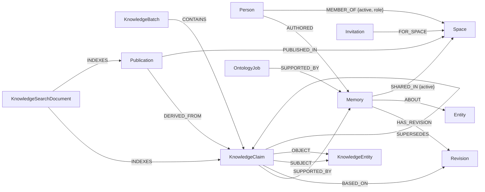

# Cypher queries and graph algorithms

This page lists the FalkorDB queries Shared Memory depends on, what each one does, and why it needs a graph. Every query is parameterized (`$user`, `$id`, …); user input is never concatenated into Cypher. Line references point to the source so each query can be checked against the code.

## In one minute

- Every memory, person, space, share, claim and search document is a node or edge in one FalkorDB graph.
- **Permissions are graph paths.** You can read a memory only if you wrote it, or if an active path connects you to it: `You -MEMBER_OF→ Space ←SHARED_IN- Memory`. This check runs on every read.
- **Recall follows edges.** After finding memories by keyword, it hops through shared entities and shared spaces to find related memories, even ones with no matching words.
- **Search runs inside FalkorDB.** Structured claims are found with FalkorDB's full-text index and HNSW vector index, filtered by the same permission paths, then neighbours are pulled in by a one-hop graph expansion.

If FalkorDB is removed, the product cannot decide who may read what, cannot find related context, and cannot search claims.

## Graph model



| Node | What it is |
|---|---|
| `Person` | A signed-in account (Clerk user ID). All of a person's assistants act as this one node. |
| `Memory` | One saved statement or outcome, with kind, text, evidence, owner and current revision number. |
| `Revision` | An immutable earlier version of a memory. Only the author can read history. |
| `Entity` | A person, project, place or topic a memory is about. IDs are hashed with the owner's ID (`src/memory.ts:195`), so two users' "OAuth" are different nodes. |
| `Space` | A shared space. Members join through `Invitation` nodes. |
| `KnowledgeClaim` | A typed fact extracted from a memory, e.g. `task:oauth HAS_STATUS completed`, with the exact evidence quote. |
| `KnowledgeEntity` | The subject or object of a claim. |
| `Publication` | A frozen snapshot of a claim shared into a space. |
| `KnowledgeSearchDocument` | Search text and embedding for a claim or publication, in a per-scope index label. |
| `OntologyJob` | A queued background extraction for one memory revision. |
| `Change` | An audit record of a share, retraction, revision or publication in a space. |
| `Connection`, `SharingRule` | A connected assistant (revocable) and an automatic sharing rule. |

Every label above has a range index and a unique constraint on `id` (`src/memory.ts:131`). Account profiles live in a separate graph (`FALKORDB_GRAPH`, `User {clerkId}`, `src/users.ts`); everything on this page is in the memory graph (`FALKORDB_MEMORY_GRAPH`).

---

## 1. Permission check

`src/memory.ts:92`, appended to every memory read.

```cypher
OPTIONAL MATCH (m)-[:SHARED_IN {active:true}]->(:Space)<-[membership:MEMBER_OF {active:true}]-(:Person {id:$user})
WITH m, count(membership) AS memberships
WHERE m.deletedAt IS NULL AND (m.owner = $user OR memberships > 0)
```

**What it does:** keeps a memory only if it isn't deleted and you either own it or there is at least one active path from you, through a space, to it.

**Why a graph:** access is a path, not a column. Revoking a member or retracting a share flips one edge's `active` flag, and the very next read stops returning the memory. Nothing is copied to other users, so there is nothing to clean up.

## 2. Saving a memory (`remember`)

`src/memory.ts:205`

```cypher
MERGE (p:Person {id:$user}) SET p.name = $name
MERGE (m:Memory {id:$id}) ON CREATE SET m.owner = $user, m.text = $text, m.kind = $kind, …, m.revision = 1, m.requestHash = $hash
WITH p, m WHERE m.deletedAt IS NULL AND m.requestHash = $hash
MERGE (p)-[:AUTHORED]->(m)
MERGE (r:Revision {id:$revisionId}) ON CREATE SET r.text = m.text, …, r.revision = 1
MERGE (m)-[:HAS_REVISION]->(r)
MERGE (job:OntologyJob {id:$revisionId}) ON CREATE SET job.owner = $user, job.status = 'pending', …
MERGE (job)-[:SUPPORTED_BY]->(m)
FOREACH (i IN range(0, size($entityIds)-1) |
  MERGE (e:Entity {id:$entityIds[i]}) ON CREATE SET e.name = $names[i], e.kind = $types[i]
  MERGE (m)-[:ABOUT]->(e))
RETURN properties(m) AS value
```

**What it does:** in one atomic query, creates the memory, its first revision, its `ABOUT` links to entities, and a background extraction job.

**Safe retries:** the memory ID is derived from the user and an idempotency key, so a retried request finds the same node instead of creating a duplicate. If the same key is reused with different content, the `requestHash` check returns no row and the API answers 409.

## 3. Recall and graph expansion (`recall`)

`src/memory.ts:254–269`

**Step 1: find seed memories by keyword**, filtered by the permission check.

```cypher
MATCH (m:Memory) <permission check>
  AND (size($terms) = 0 OR any(t IN $terms WHERE toLower(m.text) CONTAINS t
       OR toLower(m.entities) CONTAINS t OR toLower(m.authorName) CONTAINS t))
RETURN properties(m) AS value ORDER BY m.updatedAt DESC LIMIT $limit
```

**Step 2: hop through shared entities** to memories about the same thing.

```cypher
MATCH (seed:Memory)-[:ABOUT]->(e:Entity)<-[:ABOUT]-(m:Memory)
WHERE seed.id IN $ids AND NOT m.id IN $ids
WITH DISTINCT m, e <permission check>
RETURN DISTINCT properties(m) AS value, e.name AS entity ORDER BY m.updatedAt DESC LIMIT 10
```

**Step 3: hop through shared spaces** to other memories in the same space.

```cypher
MATCH (seed:Memory)-[:SHARED_IN {active:true}]->(s:Space)<-[:SHARED_IN {active:true}]-(m:Memory)
WHERE seed.id IN $ids AND NOT m.id IN $ids
WITH DISTINCT m, s <permission check>
RETURN DISTINCT properties(m) AS value, s.name AS entity ORDER BY m.updatedAt DESC LIMIT 10
```

**Why a graph:** steps 2 and 3 return related memories that share no words with the query. Each result says why it was included ("Connected through OAuth"). Every hop re-applies the permission check, so expansion can never reach a memory you couldn't read directly.

## 4. Correcting a memory (`revise_memory`)

`src/memory.ts:340`

```cypher
MATCH (m:Memory {id:$id}) WHERE m.owner = $user AND m.deletedAt IS NULL AND m.revision = $expected
SET m.text = $text, …, m.revision = $rev
CREATE (r:Revision {id:$rid, …, revision:$rev})
CREATE (m)-[:HAS_REVISION]->(r)
CREATE (job:OntologyJob {id:$rid, …}) CREATE (job)-[:SUPPORTED_BY]->(m)
WITH m OPTIONAL MATCH (m)-[link:ABOUT]->(:Entity) DELETE link
WITH DISTINCT m
FOREACH (i IN range(0, size($entityIds)-1) | MERGE (e:Entity {id:$entityIds[i]}) … MERGE (m)-[:ABOUT]->(e))
WITH m OPTIONAL MATCH (m)-[:SHARED_IN {active:true}]->(s:Space)
FOREACH (space IN CASE WHEN s IS NULL THEN [] ELSE [s] END |
  MERGE (c:Change {id:$rid + ':' + space.id}) ON CREATE SET c.kind = 'revised', …)
RETURN DISTINCT properties(m) AS value
```

**What it does:** a compare-and-swap. The update only applies if the memory is still at the revision the caller last saw (`m.revision = $expected`). Two assistants correcting the same memory at once cannot overwrite each other; the loser gets a 409 and must re-read. The query also rewires `ABOUT` edges, queues re-extraction, and writes a `Change` record into every space the memory is shared in.

## 5. Forgetting a memory (`forget_memory`)

`src/memory.ts:397–421`

```cypher
MATCH (m:Memory {id:$id}) WHERE m.owner = $user
OPTIONAL MATCH (m)-[:HAS_REVISION]->(r:Revision)
SET r.text = NULL, r.evidence = NULL, …, m.text = NULL, m.evidence = NULL, m.deletedAt = $now
WITH DISTINCT m OPTIONAL MATCH (m)-[share:SHARED_IN]->(:Space) SET share.active = false
WITH DISTINCT m OPTIONAL MATCH (m)-[link:ABOUT]->(:Entity) DELETE link
WITH DISTINCT m OPTIONAL MATCH (c:KnowledgeClaim)-[:SUPPORTED_BY]->(m)
SET c.payload = NULL, c.status = 'forgotten'
WITH DISTINCT c OPTIONAL MATCH (p:Publication)-[:DERIVED_FROM]->(c)
SET p.payload = NULL, p.active = false
```

Then three follow-up queries: mark the memory's `OntologyJob` as forgotten, `DETACH DELETE` the `KnowledgeSearchDocument` nodes reachable through its claims and publications, and remove entities nothing points to any more:

```cypher
MATCH (e:Entity) OPTIONAL MATCH (m:Memory)-[:ABOUT]->(e)
WITH e, count(m) AS refs WHERE refs = 0 DELETE e
```

**Why a graph:** "forget" has to reach everything derived from the memory: revisions, shares, extracted claims, published snapshots and search documents. The query walks those edges out from the memory, so nothing derived is left behind. Minimal IDs and timestamps remain for audit.

## 6. Spaces and sharing

**Accepting an invitation** (`src/memory.ts:516`)

```cypher
MATCH (i:Invitation {id:$id})-[:FOR_SPACE]->(s:Space)
WHERE i.email = $email AND i.expiresAt > $now AND (i.acceptedBy IS NULL OR i.acceptedBy = $user)
MERGE (p:Person {id:$user}) SET p.name = $personName
MERGE (p)-[member:MEMBER_OF]->(s)
ON CREATE SET member.active = true, member.role = i.role, member.joinedAt = $now
WITH i, s, p, member WHERE i.acceptedBy IS NULL OR member.active = true
FOREACH (_ IN CASE WHEN i.acceptedBy IS NULL AND member.role <> 'owner' THEN [1] ELSE [] END |
  SET member.active = true, member.role = i.role, member.joinedAt = $now)
SET i.acceptedBy = $user RETURN properties(s) AS value
```

The invitation must match your verified email and be unexpired. An already-used invitation link cannot re-activate a member who was revoked; that needs a fresh invitation.

**Sharing a memory** (`src/memory.ts:583`)

```cypher
MATCH (m:Memory {id:$id}), (p:Person {id:$user})-[member:MEMBER_OF {active:true}]->(s:Space {id:$space})
WHERE m.owner = $user AND m.deletedAt IS NULL AND ($enabled = false OR member.role IN ['owner','contributor'])
MERGE (m)-[share:SHARED_IN]->(s)
MERGE (c:Change {id:$event}) ON CREATE SET c.kind = $kind, …
FOREACH (_ IN CASE WHEN c.applied IS NULL THEN [1] ELSE [] END |
  SET share.active = $enabled, share.updatedAt = $now, c.applied = true)
RETURN m.id AS id
```

Only the author can share, only owners and contributors can add to a space, and the `Change` node's `applied` flag makes a retried share or retraction take effect exactly once.

**Reading a space's feed** (`src/memory.ts:462`)

```cypher
MATCH (:Person {id:$user})-[:MEMBER_OF {active:true}]->(s:Space {id:$space})<-[:SHARED_IN {active:true}]-(m:Memory)
WHERE m.deletedAt IS NULL AND ($before IS NULL OR m.updatedAt < $before OR (m.updatedAt = $before AND m.id < $beforeId))
WITH DISTINCT m RETURN properties(m) AS value ORDER BY m.updatedAt DESC, m.id DESC LIMIT $limit
```

The membership path is the query's starting point, so a non-member gets nothing. Pages use a keyset cursor (`updatedAt`, `id`) so results don't shift while new memories arrive.

## 7. The knowledge layer (claims)

### Recording claims (`record_knowledge`)

`src/knowledge.ts:153`

```cypher
MATCH (m:Memory {id:$memory})-[:HAS_REVISION]->(revision:Revision)
WHERE m.owner = $user AND m.deletedAt IS NULL AND m.revision = $revision AND revision.revision = $revision
OPTIONAL MATCH (old:KnowledgeClaim) WHERE old.id IN $supersedes AND old.owner = $user AND old.status IN ['active','disputed']
WITH m, revision, collect(old) AS olds WHERE size(olds) = $oldCount
MERGE (b:KnowledgeBatch {id:$batch}) ON CREATE SET b.requestHash = $hash, b.owner = $user
WITH m, revision, b, olds WHERE b.requestHash = $hash
FOREACH (old IN olds | SET old.status = 'superseded')
MERGE (b)-[:SUPPORTED_BY]->(m)
WITH m, revision, b UNWIND $claims AS item
MERGE (c:KnowledgeClaim {id:item.id}) ON CREATE SET c.owner = $user, c.predicate = item.predicate, …, c.sourceRevision = $revision
MERGE (c)-[:SUPPORTED_BY]->(m) MERGE (c)-[:BASED_ON]->(revision) MERGE (b)-[:CONTAINS]->(c)
MERGE (subject:KnowledgeEntity {id:item.subjectId}) ON CREATE SET subject.owner = $user, subject.kind = item.subjectType
MERGE (c)-[:SUBJECT]->(subject)
FOREACH (_ IN CASE WHEN item.objectId = '' THEN [] ELSE [1] END |
  MERGE (object:KnowledgeEntity {id:item.objectId}) … MERGE (c)-[:OBJECT]->(object))
WITH c, item OPTIONAL MATCH (prior:KnowledgeClaim {id:item.supersedes})
FOREACH (p IN CASE WHEN prior IS NULL THEN [] ELSE [prior] END | MERGE (c)-[:SUPERSEDES]->(p))
RETURN c.id AS id
```

**What it does:** attaches typed claims to the exact memory revision they were extracted from. The whole batch is rejected if the source memory has changed since it was read, or if any claim it says it corrects is no longer current. Corrections form a `SUPERSEDES` chain, so history stays queryable.

### Searching claims (`recall_knowledge`)

`src/knowledge.ts:207–440` and `src/knowledge-search.ts`

1. **Candidates.** Your own current claims (`src/knowledge.ts:217`):

   ```cypher
   MATCH (c:KnowledgeClaim)-[:SUPPORTED_BY]->(m:Memory)
   WHERE c.owner = $user AND m.deletedAt IS NULL AND ($entity = '' OR c.subjectId = $entity OR c.objectId = $entity)
     AND ($history OR (c.sourceRevision = m.revision AND c.status <> 'superseded'))
   RETURN c.payload AS payload, c.status AS status, c.sourceRevision = m.revision AS current
   ORDER BY c.recordedAt DESC, c.id DESC LIMIT 501
   ```

   And claims published into your spaces, reached only through your membership (`src/knowledge.ts:232`):

   ```cypher
   MATCH (:Person {id:$user})-[:MEMBER_OF {active:true}]->(s:Space)<-[:PUBLISHED_IN]-(p:Publication)
         -[:DERIVED_FROM]->(:KnowledgeClaim)-[:SUPPORTED_BY]->(m:Memory)
   WHERE p.active = true AND m.deletedAt IS NULL AND ($space = '' OR s.id = $space)
   RETURN DISTINCT p.payload AS payload, 'snapshot' AS status, true AS current
   ORDER BY p.publishedAt DESC, p.id DESC LIMIT 501
   ```

2. **Full-text search** in FalkorDB (`src/knowledge-search.ts:240`):

   ```cypher
   CALL db.idx.fulltext.queryNodes($label, $lexical) YIELD node, score
   MATCH (node)-[:INDEXES]->(c:KnowledgeClaim)-[:SUPPORTED_BY]->(m:Memory)
   WHERE c.owner = $user AND c.sourceRevision = m.revision AND c.status IN ['active','disputed'] AND m.deletedAt IS NULL
   RETURN c.payload AS payload, c.status AS status, score ORDER BY score DESC, c.id LIMIT 201
   ```

3. **Vector search** in FalkorDB (`src/knowledge-search.ts:259`), same permission guard:

   ```cypher
   CALL db.idx.vector.queryNodes($label, 'embedding', 200, vecf32($vector)) YIELD node, score
   <same guard> AND score <= 0.32
   RETURN c.payload AS payload, c.status AS status, score AS distance ORDER BY distance, c.id LIMIT 100
   ```

   FalkorDB's `score` here is cosine *distance* (lower is closer). If fewer than 20 hits survive the guard, an exact scan with `vec.cosineDistance(node.embedding, vecf32($vector))` over the same scope runs as a fallback (`src/knowledge-search.ts:271`), so stale index entries can't crowd out valid results.

   For a shared space, the guard instead requires `(node)-[:INDEXES]->(c:Publication)-[:PUBLISHED_IN]->(s:Space {id:$space})<-[:MEMBER_OF {active:true}]-(:Person {id:$user})` (`src/knowledge-search.ts:224`).

4. **Fusion.** The full-text and vector rankings are merged with reciprocal-rank fusion: each claim scores `Σ 1 / (60 + rank)` over the lists it appears in (`src/knowledge.ts:337`). This runs in TypeScript.

5. **One-hop expansion.** From the top claims' subject and object entities, fetch other current claims about the same entities (`src/knowledge.ts:369`):

   ```cypher
   MATCH (c:KnowledgeClaim)-[:SUPPORTED_BY]->(m:Memory)
   WHERE c.owner = $user AND m.deletedAt IS NULL AND c.sourceRevision = m.revision
     AND c.status IN ['active','disputed'] AND (c.subjectId IN $ids OR c.objectId IN $ids)
   RETURN c.payload AS payload, c.status AS status, true AS current ORDER BY c.recordedAt DESC, c.id LIMIT 201
   ```

   And the shared-space version through publications (`src/knowledge.ts:381`):

   ```cypher
   MATCH (:Person {id:$user})-[:MEMBER_OF {active:true}]->(s:Space)<-[:PUBLISHED_IN]-(p:Publication)-[:SUBJECT|OBJECT]->(e:KnowledgeEntity),
         (p)-[:DERIVED_FROM]->(:KnowledgeClaim)-[:SUPPORTED_BY]->(m:Memory)
   WHERE p.active = true AND m.deletedAt IS NULL AND ($space = '' OR s.id = $space) AND e.id IN $ids
   RETURN DISTINCT p.payload AS payload, 'snapshot' AS status, true AS current ORDER BY p.publishedAt DESC, p.id LIMIT 201
   ```

### Search indexes

`src/knowledge-search.ts:61–99`

```cypher
CREATE FULLTEXT INDEX FOR (d:<label>) ON (d.text)
CREATE VECTOR INDEX FOR (d:<label>) ON (d.embedding)
  OPTIONS {dimension: <n>, similarityFunction: 'cosine', M: 16, efConstruction: 200, efRuntime: 100}
```

Each scope (one person's private claims, or one space's publications) gets its own label, `KS_` plus a hash of the scope and embedding model (`src/knowledge-search.ts:58`). Other users' vectors therefore never compete for nearest-neighbour slots, and changing the embedding model starts a fresh index instead of mixing vectors. Documents are written with `MERGE (d:KnowledgeSearchDocument:<label> {id:$doc}) … MERGE (d)-[:INDEXES]->(c)` (`src/knowledge-search.ts:125`), and skipped when the text hash hasn't changed, so unchanged claims are never re-embedded.

### Publishing a claim to a space (`publish_claim`)

`src/knowledge.ts:561`

```cypher
MATCH (c:KnowledgeClaim {id:$claim})-[:SUPPORTED_BY]->(m:Memory),
      (:Person {id:$user})-[member:MEMBER_OF {active:true}]->(s:Space {id:$space})
WHERE c.owner = $user AND c.status IN ['active','disputed'] AND c.sourceRevision = m.revision
  AND m.deletedAt IS NULL AND member.role IN ['owner','contributor']
MERGE (p:Publication {id:$id}) ON CREATE SET p.owner = $user, p.payload = $payload, p.active = true, …
MERGE (p)-[:DERIVED_FROM]->(c) MERGE (p)-[:PUBLISHED_IN]->(s)
FOREACH (_ IN CASE WHEN p.active THEN [1] ELSE [] END | MERGE (event:Change {id:$event}) ON CREATE SET event.kind = 'published', …)
MERGE (subject:KnowledgeEntity {id:$subjectId}) ON CREATE SET subject.kind = $subjectType, subject.spaceId = $space
MERGE (p)-[:SUBJECT]->(subject)
FOREACH (_ IN CASE WHEN $objectId = '' THEN [] ELSE [1] END | MERGE (object:KnowledgeEntity {id:$objectId}) … MERGE (p)-[:OBJECT]->(object))
RETURN p.id AS id, p.active AS active
```

A publication is a frozen copy: later private corrections don't silently change what teammates already received. Retracting sets `p.active = false` and deletes its search document.

## 8. Background extraction queue

`src/ontology-extraction.ts:326` and `:454`

Every saved or revised memory gets an `OntologyJob`. A worker picks up to three due jobs:

```cypher
MATCH (j:OntologyJob)-[:SUPPORTED_BY]->(m:Memory)
WHERE j.status = 'pending' AND j.attempts < 5 AND j.nextAt <= $now
  AND (j.leaseUntil IS NULL OR j.leaseUntil < $now) AND m.deletedAt IS NULL AND j.revision = m.revision
RETURN m.id AS id, m.owner AS owner, … ORDER BY j.nextAt LIMIT 3
```

Each job is claimed with a 120-second lease and an attempt counter set in the same query (`:326`), so two workers can't process the same job. After the LLM responds, the lease and the memory's revision are checked again before anything is saved (`:366`), so a memory that was forgotten or revised mid-extraction never gets stale claims. The queue is the graph itself; there is no separate job store.

To help the extractor reuse existing entities instead of creating duplicates, it reads the author's recent claims as candidates (`:173`):

```cypher
MATCH (c:KnowledgeClaim)-[:SUPPORTED_BY]->(m:Memory)
WHERE c.owner = $user AND m.deletedAt IS NULL AND c.status IN ['active','disputed']
  AND (c.sourceRevision = m.revision OR m.id = $source)
RETURN c.payload AS payload, m.id = $source AS sameSource ORDER BY c.recordedAt DESC LIMIT 300
```

---

## Graph algorithms used

| Technique | Where | Runs in |
|---|---|---|
| Path-based authorization (owner or active membership path, re-checked on every read) | §1, §6, §7 guards | FalkorDB |
| One-hop neighbourhood expansion through `Entity`, `Space` and `KnowledgeEntity` | §3, §7 step 5 | FalkorDB |
| Full-text search (`db.idx.fulltext.queryNodes`) | §7 step 2 | FalkorDB |
| Approximate nearest-neighbour vector search (HNSW, `db.idx.vector.queryNodes`) with exact `vec.cosineDistance` fallback | §7 step 3 | FalkorDB |
| Reciprocal-rank fusion of lexical and vector rankings | §7 step 4 | TypeScript |
| Supersession chains and validity-time filtering (`SUPERSEDES`, `validFrom`/`validUntil`) | §7 | FalkorDB + TypeScript |
| Compare-and-swap writes and idempotent `MERGE` with request hashes | §2, §4, §6, §7 | FalkorDB |
| Lease-based work queue | §8 | FalkorDB |

The product does not currently call FalkorDB's built-in `algo.*` procedures (PageRank, BFS, WCC, betweenness and so on).

## What breaks without FalkorDB

- **Permissions:** there is no `can_read` table. Access exists only as `MEMBER_OF` and `SHARED_IN` edges, so without the graph nobody can be shown any shared memory.
- **Related context:** recall's "connected through X" results come from edge hops, not text similarity.
- **Claim search:** both the full-text and vector indexes are FalkorDB indexes, and their results are filtered by graph paths.
- **Forgetting and correction:** both walk outward from a memory to everything derived from it.
- **Background extraction:** the job queue lives in the graph.

## Known limits

- Recall's first step (`MATCH (m:Memory)`) and the claim queries that filter on `c.owner` start from a label scan, because only `id` is indexed. Starting from `(:Person {id:$user})` would let them grow with what the user can see rather than the total size of the graph.
- `forget` removes orphan entities with a sweep over every `Entity`.
- Graph expansion is one hop. Multi-hop query planning is not implemented.
- The extraction candidate list is capped at the author's 300 most recent claims, so older entities may be missed and recreated.
