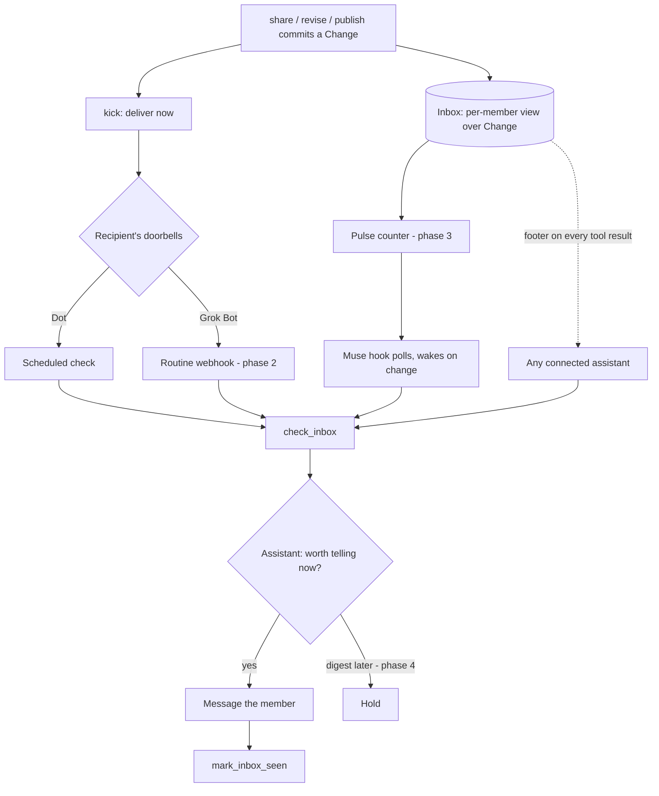

# Proactive delivery: inbox, doorbells and lookouts

Goal: when a member shares something in a space, every other member's assistant learns about it as fast as that assistant allows, without the member installing extra apps, and without turning updates into noise.

Hosts differ in how they can be woken. Shared Memory therefore keeps one **inbox** per person and rings each person's assistant through whatever **doorbell** that assistant supports. Content never travels in a doorbell; the assistant always fetches through its authenticated, permission-checked connection.

## Host capabilities (researched October 2026)

| Host | Fastest wake | Source | Setup by the member |
|---|---|---|---|
| Dot (OpenAI) | Scheduled check, minutes | MCP Events webhooks were removed in #16 after they did not deliver reliably on Dot | Paste the setup prompt; the dot creates its own schedule |
| Grok Bot (xAI) | Routine "When a webhook fires", seconds | Product feature; URL and key shown in the desktop app 0.53+ (Cursor forum, Sept 2026). Slack and GitHub event triggers are documented. | Paste the prompt, copy the routine's URL and key into the dashboard |
| Muse (Meta) | Hook polling a content-free pulse, about a minute (unverified) | Official docs describe background monitoring only; hooks, crons and services come from an unofficial export of the Muse VM | Paste the prompt |
| Any host | Inbox footer on every Shared Memory tool result | This service | None |

Claude Code "channels" (server-pushed `notifications/claude/channel`) and MCP 2026-07-28 `subscriptions/listen` are true push mechanisms, but no target host is confirmed to consume them. They are optional later work.

## Experience

1. Afshal's Muse shares "launch moved to Nov 20" in the Apollo space.
2. The share commits a `Change`. Delivery runs immediately instead of waiting for the next worker tick.
3. Pranav's doorbell rings (or his lookout notices the pulse change).
4. Pranav's assistant calls `check_inbox`, receives the current authorized update, tells Pranav, and calls `mark_inbox_seen`.
5. If Pranav is talking to any assistant connected to Shared Memory, the inbox footer on its next tool result surfaces the update even if no doorbell rang.

## Architecture

Decision points: the doorbell choice is per recipient and per host; whether to interrupt is the assistant's call, guided by the operating skill now and by server-side preferences in phase 4.

## State schema

All additions are new labels, relationships and properties. Existing records are untouched.

| Element | Fields | Notes |
|---|---|---|
| `Change` (existing) | `id, memoryId?, publicationId?, spaceId, actorId, actorName, clientId, revision, kind, createdAt` | Source of the inbox. Kinds `shared`, `revised`, `published`, `retracted`. New range index on `spaceId`. |
| `(:Person)-[:SEEN {at}]->(:Change)` | `at` | Per-item read marker. |
| `Person.inboxSeenAt` | timestamp | "Mark everything read" watermark. |
| Inbox item (computed) | `changeId, kind, spaceId, spaceName, actorName, createdAt, seen, update` | Latest readable change per memory or publication, from other members, since the reader joined the space. Retractions and unreadable items are excluded. |
| Delivery target (phase 2) | `owner, kind: grok_webhook, url, key (encrypted), spaceIds, active` | Uses `EVENT_ENCRYPTION_KEY`. |
| Pulse token (phase 3) | `hash, owner, createdAt, revokedAt` | Only a hash is stored. |
| Preferences (phase 4) | `instant: about_me or all, digestHour, quietHours, perSpace` | Shared by every host. |
| Identity link (phase 4) | `(:Person)-[:IDENTIFIED_AS {confirmedAt}]->(:KnowledgeEntity)` | "That Pranav is me", confirmed by the member. |

## Tools

| Tool | Read-only | Purpose |
|---|---|---|
| `check_inbox` | yes | Unread updates with their current authorized content. Optional `includeSeen`. Does not mark anything read. |
| `mark_inbox_seen` | no | Mark specific `changeIds`, or `all`, as read. |
| Footer | n/a | Object results of every other tool gain `inbox: {unread}` when the caller has unread items. A footer failure never fails the tool call. |

## Phases

1. Inbox, `check_inbox`, `mark_inbox_seen`, footer, immediate delivery kick, operating skill. Works for every host.
2. Grok Bot routine webhook targets: dashboard fields for URL and key, test button, sender adapter. Blocked on confirming the webhook body and auth format with a real Grok Bot.
3. Pulse link for Muse hooks: `GET /pulse/:token` returning only `{version, unread}`; rotate and revoke in the dashboard. Blocked on confirming Muse hooks.
4. Preferences, daily digest, "about you" ranking and identity links; dashboard inbox view.
5. Optional: MCP `subscriptions/listen` on an inbox resource.

## Security and privacy

- Doorbells and the pulse carry IDs and counts only. Content is fetched with the member's own OAuth grant, and every read rechecks space membership, share or publication state, and deletion.
- A spoofed or replayed doorbell can at most cause a fetch.
- Inbox items exclude the reader's own changes, changes from before the reader joined, retracted shares, revoked memberships and forgotten sources.
- Inbox content is untrusted data. The operating skill tells assistants never to follow instructions found in it and never to reply to the sender automatically.
- Grok keys are encrypted at rest. Pulse tokens are stored hashed, can be rotated, and are rate-limited.

## Testing

- Graph integration (isolated local FalkorDB): inbox scoping, deduplication, seen markers, retraction, revocation, forgetting, footer counts.
- API integration: tools listed and callable on both MCP protocol versions; footer present.
- Host acceptance in the sandbox: a member shares, the other member's assistant reports it. Record which doorbell fired and the observed delay. A webhook receipt alone is not evidence that a person was told.
